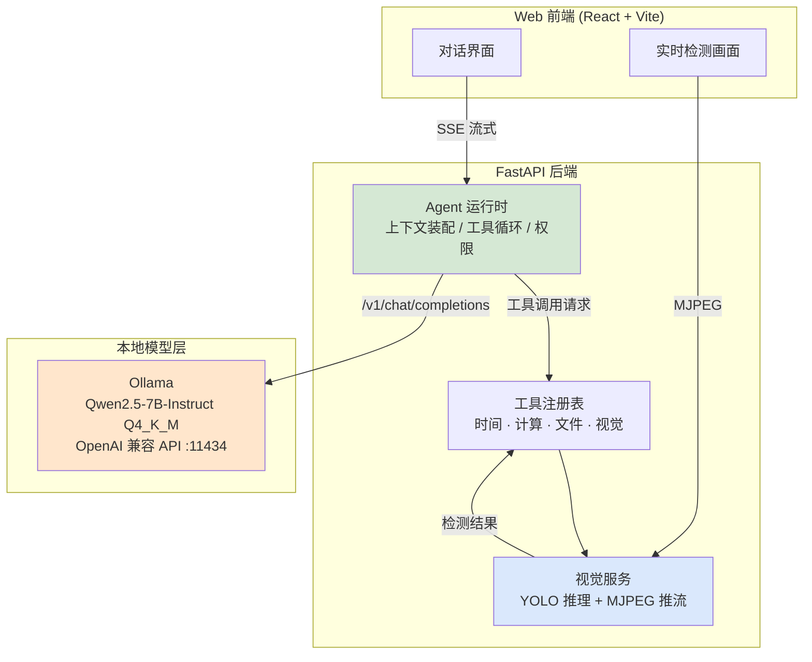

# 华小牛 HuaNiu

> 一个跑在你自己电脑上的视觉智能体：本地大模型 + 自建 Agent 运行时 + 实时视觉检测，全部装在一个 Web 应用里。
>
> 人工智能协会创智部二面 · 实战部分

---

## 一句话说明

华小牛做的事很简单：**让一个完全跑在本地的模型，能看、能想、能动手。**

- **能看** —— YOLO 实时检测摄像头画面
- **能想** —— 本地部署的 Qwen2.5-7B，不经过任何云端
- **能动手** —— 自建的 Agent 运行时，模型可以自己调用工具

整套系统断网也能跑（模型权重在本地），数据不出本机。

---

## 为什么这么选型

面试要求里列了很多选项（Dify / n8n / 扣子、Electron / Tauri、小程序……）。
我逐个权衡后**主动做减法**，理由如下：

| 决策 | 选择 | 为什么放弃另一个 |
| --- | --- | --- |
| 智能体框架 | **手写 Agent 运行时** | Dify/n8n 要跑 Docker。本机只有 16GB 内存，实测空闲仅 6.5GB，Docker 全家桶会把机器拖垮。更重要的是——**自己写才能在面试时讲清每一环**，拖一个 Dify 出来只能说「我配了配」 |
| 模型服务 | **Ollama**（OpenAI 兼容 API） | 它把 GGUF 加载、显存卸载、HTTP 服务都做好了，暴露的是标准 `/v1/chat/completions`。我的后端只依赖这个**标准协议**，哪天换成 vLLM / llama.cpp / 云端都不用改代码 |
| 应用形态 | **Web（React + FastAPI）** | 一套后端同时承载对话流和视频流，展示效果最直接。桌面端留作后续 |
| 模型权重来源 | **魔搭社区 ModelScope** | GitHub Release 下载慢，魔搭在国内快得多，且支持断点续传 |

> 题目里那句「AI 会不断把事情变繁琐，而你要做减法」我理解为：**不要堆功能，要能说清每个东西为什么存在。**

---

## 本机环境（实测）

| 项目 | 实测值 | 约束 |
| --- | --- | --- |
| GPU | RTX 5060 Laptop **8GB** / CUDA 13.1 | 决定模型规模与训练 batch |
| 内存 | **15.5 GB**（实测空闲仅 6.5GB） | ⚠️ 本项目最大的瓶颈 |
| 磁盘 | C 盘 204GB / D 盘 520GB 可用 | 宽裕 |
| 工具链 | git 2.55 / node 22 / python 3.13 | — |

**这些数字不是摆设，它们直接决定了下面的每一个参数**：
- 模型选 7B Q4_K_M（4.36GB）而不是更大的 —— 要留显存给 YOLO
- 训练用 `yolov8n` + `imgsz=640` —— 8GB 显存的安全区
- 不跑 Docker —— 内存不够

---

## 架构



**关键点：模型只是一个「可被替换的 provider」。**
后端通过标准 OpenAI 协议调用它，所以本地 / 云端切换只需要改一个环境变量。

---

## 目录结构

```
HuaNiu/
├── README.md            你正在看的这个文件
├── DEVLOG.md            工程日志：进度、卡点、当时的想法
├── AI_USAGE.md          AI 使用情况说明（题目要求如实说明）
├── docs/                分模块的详细文档
├── scripts/             一键脚本（装环境 / 起服务）
├── server/              Python 后端：Agent 运行时 + 视觉服务
│   └── app/
│       ├── agent/       Agent 主循环、工具注册、提示词装配
│       ├── llm/         model provider 抽象（OpenAI 兼容协议）
│       ├── vision/      YOLO 推理与视频流
│       └── api/         HTTP 路由
├── web/                 React 前端
├── training/            YOLO 训练脚本与配置（独立于服务端）
├── models/              模型权重（不入库，脚本下载）
├── data/                数据集（不入库）
└── runs/                训练产物（不入库）
```

**为什么训练和推理分开？** 训练是一次性实验行为，推理是线上服务行为。混在一起会让服务依赖训练库（torch），把后端变重。分开之后后端可以很轻，训练和推理只通过「权重文件」这个契约耦合。

---

## 快速开始

```bash
# 1. 搭建环境（装 Ollama、拉模型、建虚拟环境、装依赖）
./scripts/setup.ps1

# 2. 启动（后端 :8000 + 前端 :5173）
./scripts/dev.ps1
```

浏览器打开 <http://localhost:5173>。

> 详细的手动步骤见 [`docs/01-环境准备.md`](docs/01-环境准备.md)，脚本是这些步骤的封装，不是黑盒。

---

## 分模块说明

| 模块 | 文档 | 状态 |
| --- | --- | --- |
| 本地大模型部署 | [docs/02-大模型部署.md](docs/02-大模型部署.md) | 进行中 |
| 智能体运行时设计 | [docs/03-智能体设计.md](docs/03-智能体设计.md) | 待开始 |
| YOLO 训练 | [docs/04-YOLO训练.md](docs/04-YOLO训练.md) | 待开始 |
| Harness | [docs/05-Harness.md](docs/05-Harness.md) | 待开始 |

---

## 进度

真实的进度和踩过的坑记在 [`DEVLOG.md`](DEVLOG.md)。
**那里面会有失败和卡住的记录**，我刻意不删——面试要求记录「长时间因为什么而卡住进度」，日志只写好不看的部分是没价值的。

---

## 硬件部分

目前手上没有单片机，第三部分先用 **Wokwi 在线仿真 + 串口协议模拟** 完成「AI 控制点灯」的闭环验证，协议层代码写好，真机上电即可复用。详见 `docs/06-硬件.md`。

---

## 许可与致谢

- 模型权重来自 [魔搭社区](https://www.modelscope.cn/) 的 `lmstudio-community/Qwen2.5-7B-Instruct-GGUF`
- 训练框架 [ultralytics](https://github.com/ultralytics/ultralytics)
- 推理服务 [Ollama](https://github.com/ollama/ollama)
